# Nexus Windows 桌面版操作手册

> **适用版本：2.8.x**（本手册按 2.8.0 界面编写）
> 截图中的 `Demo App`、`api`、`worker` 以及路径/用户名都是隔离演示环境，不是你的真实项目或机器信息。
> 最新手册入口：[`docs/manuals/README.md`](../../README.md)

---

## 目录

1. [Nexus 是做什么的](#1-nexus-是做什么的)
2. [安装与第一次打开](#2-安装与第一次打开)
3. [界面总览](#3-界面总览)
4. [创建项目](#4-创建项目)
5. [添加服务](#5-添加服务)
6. [启动、停止、重启与状态](#6-启动停止重启与状态)
7. [查看日志](#7-查看日志)
8. [文件树与编辑器](#8-文件树与编辑器)
9. [服务模板、工具命令与打开方式](#9-服务模板工具命令与打开方式)
10. [Windows 登录前开机启动](#10-windows-登录前开机启动)
11. [AI 助手、Node 版本与设置](#11-ai-助手node-版本与设置)
12. [常见问题](#12-常见问题)
13. [快捷键](#13-快捷键)

---

## 1. Nexus 是做什么的

Nexus 是一个 Windows 本地开发环境管理器。它把多个项目的多个服务集中在一个窗口里：

- 配置服务的启动命令、工作目录、环境变量；
- 一键启动/停止/重启单个服务或整个项目；
- 查看实时日志；
- 浏览项目文件、编辑代码；
- 配置 Windows 登录前的开机启动；
- 通过内嵌 AI 助手查询/操作项目和服务。

**它不替代 Node、Java、Python、Tomcat 本身**，只负责在正确的时机启动、停止、检查状态和记录日志。服务需要的运行时仍要自己安装。

---

## 2. 安装与第一次打开

### 2.1 系统要求

- Windows 10 / 11，64 位；
- 系统自带 **WebView2**（Win11 和较新的 Win10 已内置；没有时安装器会提示）。

### 2.2 下载哪个文件

打开 GitHub Releases：

```text
https://github.com/hixingchen/nexus/releases
```

选择 **2.8.x** 的 Windows 资产：

| 文件 | 用途 |
|---|---|
| `Nexus_2.8.0_x64-setup.exe` | NSIS 安装器，双击安装，推荐 |
| `Nexus_2.8.0_x64_en-US.msi` | MSI，适合静默/批量部署 |

> Linux 服务端版是独立资产，不在 Windows 安装包里；两者版本号可能相同，但程序不同。

### 2.3 安装并启动

1. 双击 `Nexus_2.8.0_x64-setup.exe`；
2. 按向导完成安装；
3. 从开始菜单或桌面启动 Nexus；
4. 第一次启动会创建数据目录，默认在：

```text
C:\Users\<你的用户名>\.nexus\
```

普通本地开发不需要管理员权限。只有“Windows 登录前开机启动”在安装启动器时需要一次管理员授权。

---

## 3. 界面总览

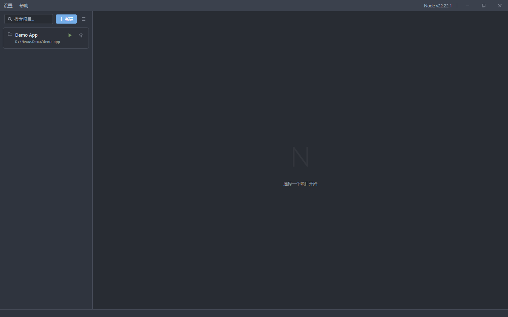

第一次打开时左侧是空的，点「新建」创建项目；下图是添加了演示项目后的主界面。

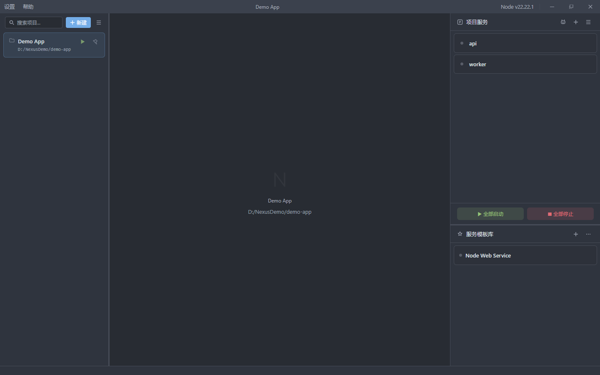

选中项目后，界面大致分三栏：

| 区域 | 内容 |
|---|---|
| 左侧 | 项目列表、搜索、项目目录树；双击项目卡片可展开目录树 |
| 中间 | 项目工作区：文件编辑器、日志、欢迎页 |
| 右侧 | 项目服务列表、全部启动/停止、服务模板库 |

顶部还有：

- 左上角「设置」「帮助」；
- 中间当前项目名；
- 右上角 Node 版本按钮、窗口最小化/最大化/关闭。

> 关闭窗口是否退出程序取决于「设置 > 通用 > 关闭窗口时最小化到托盘」：开启后关闭只隐藏窗口，服务继续运行；默认关闭，关闭窗口即退出。详见设置。

---

## 4. 创建项目

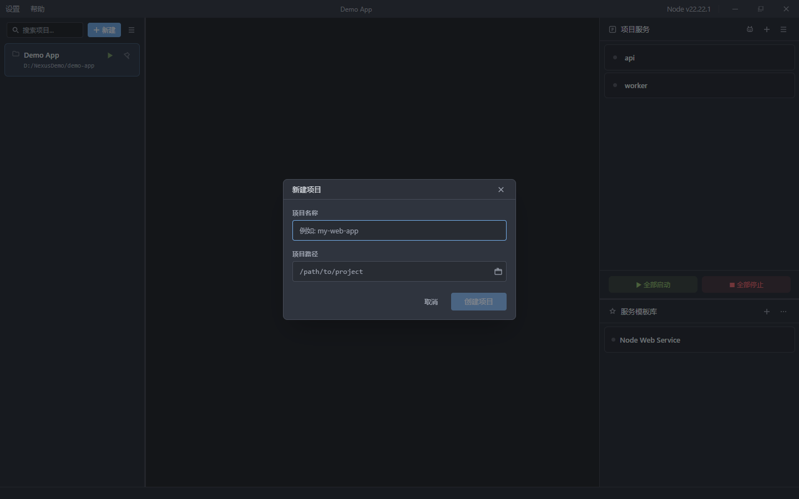

1. 点左侧「**+ 新建**」；
2. 填「项目名称」；
3. 点路径框右侧的文件夹按钮，选择**已存在的项目目录**；
4. 点「**创建项目**」。

路径必须是真实存在的目录。创建后项目会出现在左侧列表：

- 单击：选中项目；
- 双击：展开/收起项目目录树；
- 卡片上的 ▶：启动项目下全部服务；
- 卡片上的 ☆：收藏项目，收藏的排在最前；
- 右键：更多项目操作（重命名、复制、删除等）。

---

## 5. 添加服务

### 5.1 打开添加面板

在右侧「项目服务」标题栏点 **+**：

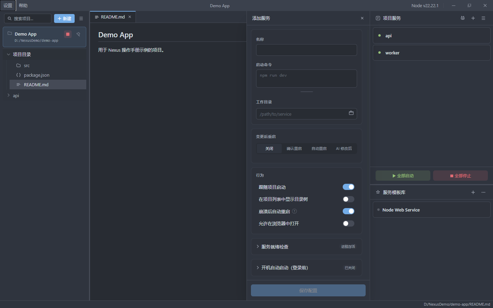

### 5.2 必填字段

| 字段 | 说明 |
|---|---|
| 名称 | 服务名，例如 `api`、`worker`、`web` |
| 启动命令 | 在终端里启动服务的那条命令 |
| 工作目录 | 命令在哪个目录执行；留空默认项目根目录 |

示例：

```bat
npm run dev
node src/server.js
mvn spring-boot:run
python -m http.server 8000
```

> 命令是通过 `cmd /C` 执行的；需要 PowerShell 语法时，把命令写成 `powershell -NoProfile -Command "..."`。

### 5.3 常用行为开关

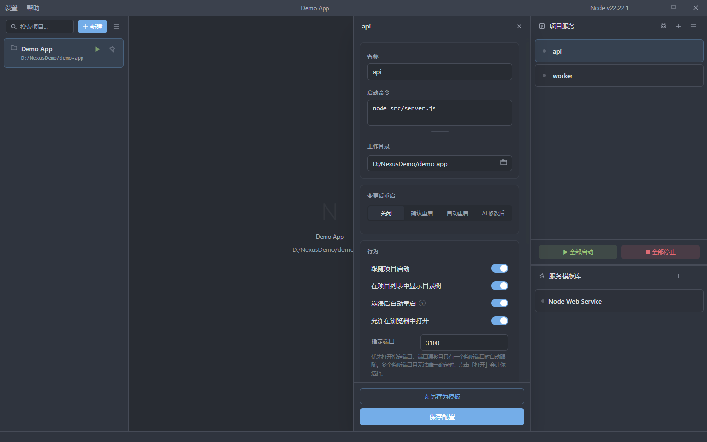

| 开关 | 含义 |
|---|---|
| 跟随项目启动 | 点项目卡片的 ▶ 时，是否一起启动这个服务 |
| 在项目列表中显示目录树 | 在左侧项目树里额外显示该服务的工作目录 |
| 崩溃后自动重启 | 服务稳定运行后崩溃时自动拉起（启动失败/秒退不会无限重启） |
| 允许在浏览器中打开 | 服务卡片出现「打开」按钮；可指定端口 |

「变更后重启」用于控制文件变化时是否自动重启服务（关闭 / 确认 / 自动 / AI 修改后）。

### 5.4 就绪检查

服务进程起来了不代表能用了。Nexus 支持：

| 检查 | 写法/含义 |
|---|---|
| 进程存活 | 默认，进程在就算就绪 |
| TCP 端口 | 能连上 `127.0.0.1:端口` 才算就绪，适合 Web/API/数据库 |
| 日志关键字 | 日志出现指定文字才算就绪 |
| 固定等待 | 启动后等 N 秒 |

Web 服务建议填 TCP 端口；Tomcat 可填 `8080`。

### 5.5 开机自动启动

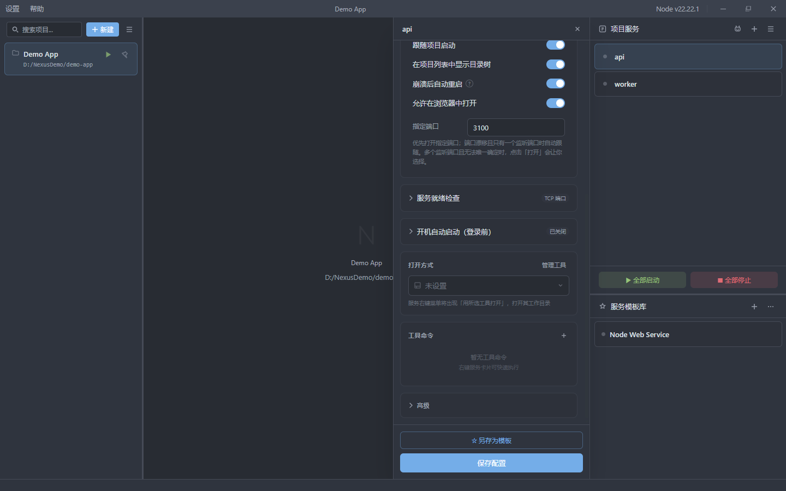

「开机自动启动（登录前）」只在需要 **Windows 登录前** 拉起服务时打开；它和「跟随项目启动」是两件事：

- 跟随项目启动：Nexus 打开、点项目启动时生效；
- 开机自动启动：安装对应启动器后，登录 Windows 前由计划任务拉起。

打开后还需要在「设置 > 服务开机启动」安装 S4U 或保存密码启动器，详见第 10 节。

### 5.6 工具命令与打开方式

服务编辑面板下半部分还有：

- **打开方式**：绑定 IDEA、VS Code、资源管理器等外部工具；
- **工具命令**：给这个服务配置构建、清理等常用命令，右键服务卡片可执行；
- **高级**：模板/工具等高级配置；
- **保存配置**：修改后必须点一次保存。

---

## 6. 启动、停止、重启与状态


- 单个服务：服务卡片上的 ▶ 启动、■ 停止、↻ 重启；
- 整个项目：右侧底部「▶ 全部启动」「■ 全部停止」；
- 服务卡片绿点表示运行中，红点/失败状态会给出原因；
- 「打开」按钮在配置了浏览器打开/端口后出现。

服务状态常见值：

| 状态 | 含义 |
|---|---|
| 运行中 / ready | 已启动并通过就绪检查 |
| 启动中 | 进程已起，正在等就绪 |
| 失败 | 启动失败或异常退出；日志里通常有原因 |
| 已停止 | 正常停止 |

> 如果服务设置了“开机自动启动”，但对应启动器还没安装，直接点本地启动可能提示“配置为开机启动，但对应启动器未运行”。要么先安装启动器（第 10 节），要么临时关闭该服务的开机自动启动。

### 停止与重启

- **停止**会结束服务进程树；需要等待服务自己收尾时，给服务留出时间；
- **重启** = 停止后再启动，适合改完配置后重新加载；
- 崩溃自动重启只在“稳定运行后意外退出”时触发；启动失败不会无限重启。

### 端口冲突

启动时如果检测到端口被占用，Nexus 会弹窗显示占用进程，可选择：

- 结束占用进程后重试；
- 打开占用者所在目录；
- 取消启动，改端口配置。

---

## 7. 查看日志

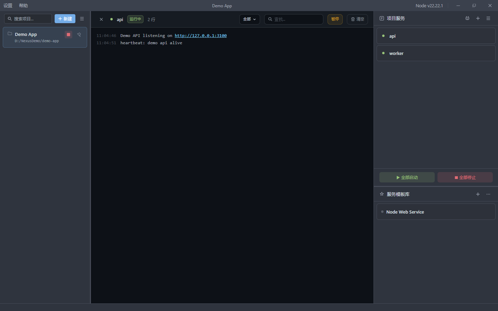

1. 启动服务后，点服务卡片上的「日志」；
2. 中间会打开日志标签页；
3. 顶部可以：

| 控件 | 作用 |
|---|---|
| 日志级别下拉 | 全部 / 只看错误 / 只看警告及以上 |
| 查找 | 搜索关键字并跳转 |
| 暂停 | 暂停自动滚动/刷新 |
| 清空 | 清空当前服务日志缓冲 |

说明：

- 日志标签页顶部会显示服务状态和行数；
- 只保留最近一段日志（每个服务有内存/文件上限）；
- 服务自己另写日志文件（例如 Tomcat 的 `logs/catalina.out`）时，Nexus 只能显示它捕获到的 stdout/stderr；要看服务自己的文件，请直接打开对应目录；
- 打包版没有控制台，Nexus 自身日志在：

```text
C:\Users\<你的用户名>\.nexus\logs\nexus.log
```

设置 > 通用里可以直接打开数据目录和日志文件。

---

## 8. 文件树与编辑器

### 8.1 展开项目目录

双击左侧项目卡片，展开「项目目录」：

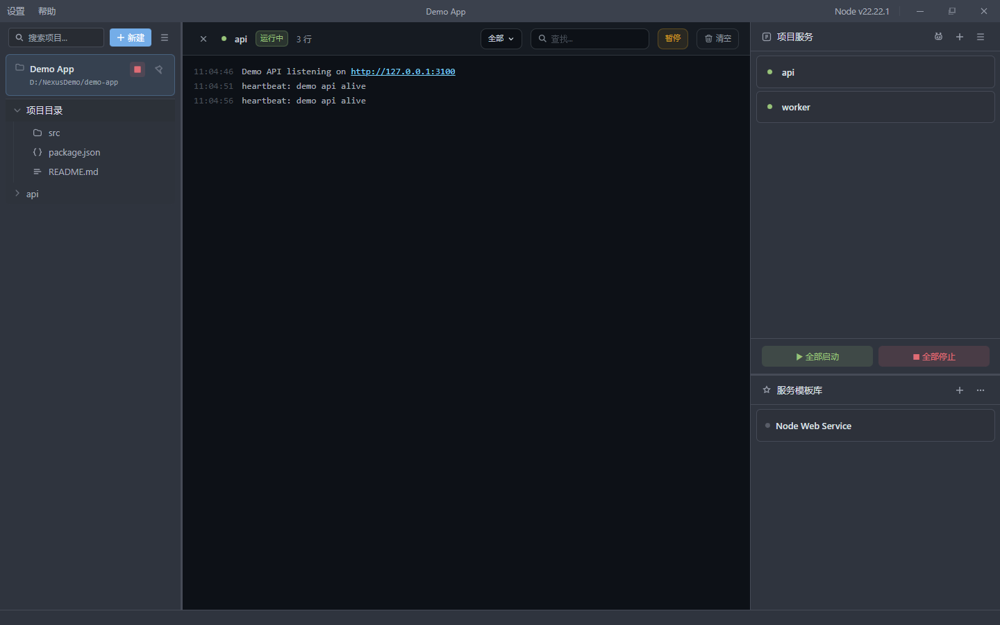

- 点文件夹展开/收起；
- 服务如果开启了“在项目列表中显示目录树”，还会出现该服务自己的工作目录树；
- 右键文件/文件夹可以新建、重命名、删除等（删除走系统回收站）。

### 8.2 打开和编辑文件

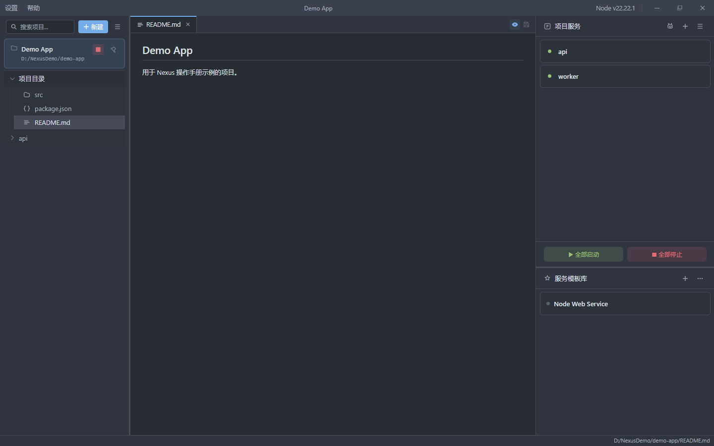

1. 点文件树里的文件，中间打开标签页；
2. 编辑器会自动识别 UTF-8 / GB18030 编码和换行风格，保存时按原格式写回；
3. Markdown 默认显示渲染预览，标签栏右侧可切回源码；
4. 右上角保存按钮或 `Ctrl+S` 保存；有未保存修改时标签会有标记。

支持常见代码/配置文件，也支持图片预览、十六进制视图、PDF/Word 只读预览、jar/class 查看；PDF 支持文本选中。

### 8.3 关闭与草稿

- 关闭标签：标签上的 ×，或 `Ctrl+W`；
- 未保存修改可能有确认/草稿提示；
- 从文件树重新打开同一文件时，未保存草稿仍在。

---

## 9. 服务模板、工具命令与打开方式

### 9.1 服务模板库

右侧「服务模板库」用于跨项目复用配置：

1. 在服务编辑面板点「☆ 另存为模板」；
2. 或点模板库标题栏的 **+** 新建模板；
3. 选中模板后可「添加到项目」；
4. 模板可以导出/导入 JSON，换机器时用。

### 9.2 工具命令

服务编辑面板 →「工具命令」：

- 添加构建、清理、测试等常用命令；
- 右键服务卡片可快速执行；
- 执行结果会显示在弹窗里，可停止、可查看输出；
- 命令可以配置超时；不要让工具命令长期挂起。

### 9.3 打开方式

服务编辑面板 →「打开方式」：

- 选择 IDEA、VS Code、资源管理器等工具；
- 右键服务卡片「用所选工具打开」；
- 工具不存在时会提示，可在「管理工具」里补齐。

---

## 10. Windows 登录前开机启动

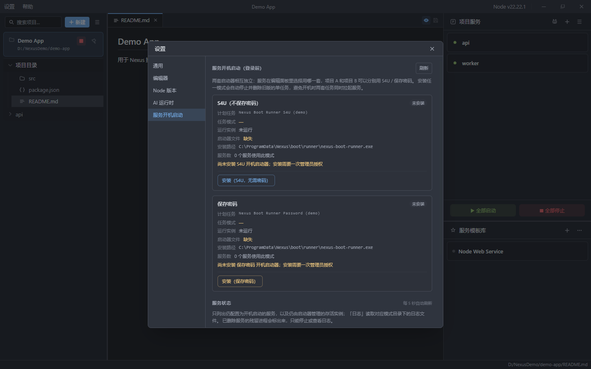

### 10.1 先理解两套启动器

| 模式 | 是否需要密码 | 适用 |
|---|---|---|
| S4U | 不需要保存密码 | 大多数本地服务；不能访问网络共享 |
| 保存密码 | 需要 Windows 原生凭据框输入一次 | 服务需要访问网络共享等 S4U 受限资源 |

两套启动器都以**当前用户**运行，不会用 SYSTEM 身份运行你的服务。项目 A 和项目 B 可以分别选择不同模式。

### 10.2 配置步骤

1. 服务编辑面板打开「开机自动启动（登录前）」；
2. 设置启动顺序、就绪检查、是否阻断后续服务；
3. 打开「设置 > 服务开机启动」；
4. 选择 S4U 或保存密码，点「安装」；
5. 首次安装需要一次管理员授权；
6. 用「测试启动」验证登录前能否正常拉起。

### 10.3 注意事项

- 「跟随项目启动」不等于「登录前开机启动」；
- 如果服务标了开机启动但启动器未安装，本地启动会跳过并提示；
- Docker Desktop、需要桌面环境的程序、依赖网络共享的服务不适合登录前启动；
- Windows 快速启动可能让“关机→开机”走混合恢复；登录前服务没启动时先用「测试启动」排查；
- 修复/重新安装启动器会先停止它拉起的服务，安装后原本运行的服务会自动恢复；
- 卸载启动器会停止全部开机服务并删除计划任务；残留进程可在设置里「结束残留启动器」。

---

## 11. AI 助手、Node 版本与设置

### 11.1 AI 助手

右侧「AI 助手」用于让 AI 查询/操作 Nexus：

- 首次使用需要下载 Nexus 自带的 AI 运行时（约 300MB，仅一次）；
- AI 运行时使用 Nexus 自己的 Node 与 dsh，**不受你本机 nvm/Node 版本影响**；
- AI 可以通过 MCP 工具查询项目/服务、启动/停止/重启服务、读取日志、修改服务配置；
- 删除类等不可逆操作会弹确认，AI 不能自己关闭确认；
- 如果内网下载不通，可在「设置 > AI 运行时」手动指定已有的 Node 和 dsh，Nexus 会先验证再保存。

### 11.2 Node 版本

- 点击标题栏右上角的 `Node vX.Y.Z`；
- 或「设置 > Node 版本」；
- 使用 nvm-windows 管理已安装 Node：查看、切换、安装、卸载；
- 切换后新启动的服务使用新版本；已经运行的服务要重启才生效；
- 没装 nvm 时可在面板里按提示安装。

### 11.3 设置

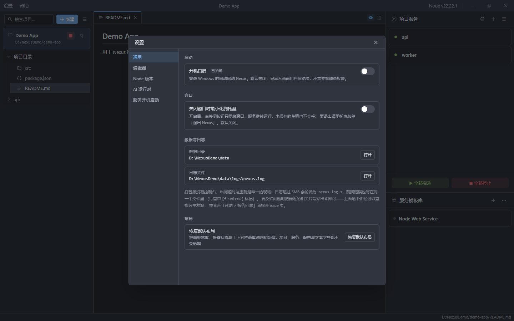

| 分类 | 能做什么 |
|---|---|
| 通用 | 开机自启 Nexus（可选）、关闭窗口最小化到托盘、打开数据/日志目录、恢复默认布局 |
| 编辑器 | 文本字号 12–20px；代码、预览、日志同步跟随 |
| Node 版本 | nvm-windows 图形界面 |
| AI 运行时 | 查看/安装/卸载/手动指定 AI 运行时 |
| 服务开机启动 | S4U / 保存密码启动器安装、状态、测试、日志 |

「恢复默认布局」只恢复面板尺寸/折叠/分栏，不影响项目、服务、配置和字号。

### 11.4 帮助

- 「帮助 > 使用说明」：内嵌本仓库 README；
- 「帮助 > 关于」：版本、许可、第三方组件；
- 「帮助 > 报告问题」：直接打开 issue 页面；
- 「帮助 > 检查更新」。

---

## 12. 常见问题

### 服务启动失败 / 命令找不到

1. 打开服务日志或日志标签页；
2. 确认「工作目录」正确；
3. 在普通终端里手动执行同一条命令，确认 Node/Java/Python 在 PATH 中；
4. 用 `where node`、`where java` 检查路径；
5. 环境变量写错时，在服务编辑面板的「高级/环境变量」里修正。

### 日志里没有输出

- 服务把输出重定向到自己文件（Tomcat `catalina.out`、某些启动脚本）；
- 服务命令自己转后台后父进程退出；
- 用前台命令（如 `catalina.sh run`）或打开服务自己的日志文件。

### 端口被占用

启动时弹窗会显示占用进程：结束它、打开它所在目录，或换端口。

### 关闭窗口后服务还在跑

检查「设置 > 通用 > 关闭窗口时最小化到托盘」。如果希望关闭即退出，用托盘菜单「退出 Nexus」。

### Windows 登录前没有启动

- 服务是否打开了「开机自动启动（登录前）」；
- 设置 > 服务开机启动里启动器是否已安装且状态正常；
- 是否用「测试启动」验证过；
- Docker Desktop、桌面程序、网络共享依赖服务不支持登录前启动；
- Windows 快速启动可能影响“关机→开机”。

### AI 一直下载失败

- 检查网络/代理；
- 设置 > AI 运行时里手动指定本机 Node 和 dsh；
- 首次下载约 300MB，请留出磁盘与时间。

### 电脑上好像有两个 Nexus

可能同时开着“安装版”和开发版。用「帮助 > 关于」看版本和路径；不确定时关闭其中一个再试。

### 数据在哪里，怎么备份

- 数据、数据库、日志默认在 `C:\Users\<你的用户名>\.nexus\`；
- 设置 > 通用可以一键打开；
- 备份这个目录即可；恢复时退出 Nexus 后覆盖回来。

---

## 13. 快捷键

| 快捷键 | 作用 |
|---|---|
| `Ctrl+S` | 保存当前文件 |
| `Ctrl+F` | 编辑器/日志查找 |
| `Ctrl+Z` | 撤销 |
| `Ctrl+Shift+Z` | 重做 |
| `Ctrl+W` | 关闭当前标签 |
| `Esc` | 关闭弹窗/面板 |
| `Ctrl+鼠标滚轮` | 调整文本字号 |
| `Tab` / `Shift+Tab` | 编辑器缩进/反缩进 |
| 项目列表 `↑`/`↓` | 切换项目 |
| 项目列表 `→`/`←` | 展开/收起项目目录树 |

---

## 手册版本说明

- 本手册对应 **2.8.x** 界面；
- 后续只有 UI/操作流程大改时才新建 `windows/vX.Y.Z/`，小版本继续复用本手册；
- 版本索引与维护约定见 [`docs/manuals/README.md`](../../README.md)。
